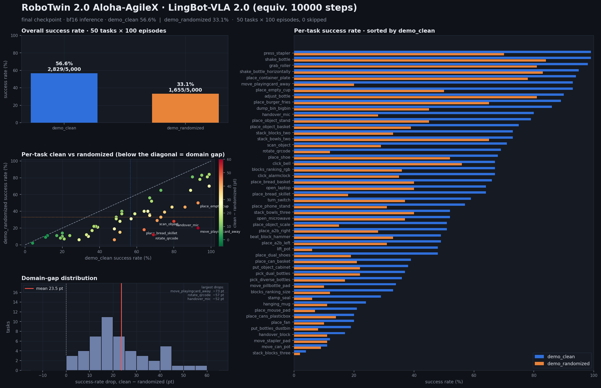
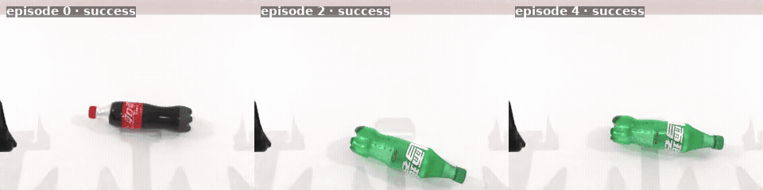

# Botgame — 蚂蚁灵波具身大模型挑战赛 · RoboTwin 2.0

基于 **LingBot-VLA 2.0（6B）** 在 **RoboTwin 2.0 Aloha-AgileX 50 任务**上完成全量微调，
按官方协议跑了两个 setting 的全量闭环评测（每 setting 50 任务 × 100 局）。

> 个人项目：训练、评测、文档与提交均由一名维护者完成；未对官方模型/代码做算法层面的改进，
> 提交的是按官方配方微调后的全量权重。

## 最终成绩

| setting | 任务数 | 局数 | 成功 | 成功率 |
|---|---:|---:|---:|---:|
| `demo_clean` | 50 | 5,000 | 2,829 | **56.6%** |
| `demo_randomized` | 50 | 5,000 | 1,655 | **33.1%** |

- **提交权重**：`hf_ckpt_final_equiv10000`（等效 10,000 步，全量微调，单权重）
- **同口径对照**：等效 6600 步基线 19.2% → 等效 10000 步 52.5%（20 任务 × 30 局，约 **2.7×**）
- **评测口径**：BF16 推理，seed 由客户端按 `100000 + episode` 生成；无 TTA、ensemble、多 seed 投票
- **耗时**：clean 5,000 局约 8.9 h；randomized 5,000 局约 7.3 h（6×RTX 4090 48G，12 并发槽）



逐任务热力图：`docs/submission/2026-10-21/01_评测结果/eval_results_heatmap.png`；
逐任务动画：`eval_results_animation.gif`；官方模板：`results.json`。

## 实拍回放（评测环境，非训练数据）

`adjust_bottle` 单任务评测中连续 6 局全部成功（clean）。下面是 3 局成功回放的并排动图，
完整素材在 [`videos/`](docs/submission/2026-10-21/01_评测结果/videos/)：



| 素材 | 说明 |
|---|---|
| [episode 0 GIF](docs/submission/2026-10-21/01_评测结果/videos/adjust_bottle_episode0.gif) / [MP4](docs/submission/2026-10-21/01_评测结果/videos/adjust_bottle_episode0.mp4) | 单局完整回放（约 12 s） |
| [episode 2 GIF](docs/submission/2026-10-21/01_评测结果/videos/adjust_bottle_episode2.gif) | 单局完整回放 |
| [episode 4 GIF](docs/submission/2026-10-21/01_评测结果/videos/adjust_bottle_episode4.gif) | 单局完整回放 |
| [三局并排 GIF](docs/submission/2026-10-21/01_评测结果/videos/adjust_bottle_success_montage.gif) / [MP4](docs/submission/2026-10-21/01_评测结果/videos/adjust_bottle_success_montage.mp4) | 成功片段合集 |

录制方式见 `scripts/eval.sh --video`（正式全量评测默认关闭录像以提速）。

## 关键结论

1. **数据语义对齐是最大转折点**。早期数据从“就位抓取姿态”起步，而评测环境从零位形起步，
   闭环一开始 0%；换用官方 14 维关节空间 `joint_v30` 数据（episode 首帧与评测初始状态一致）后，
   闭环成功率回到 50%+。
2. **配方对齐官方基线**。AdamW、lr 5e-5 恒定、warmup 3%、BF16、global 96、image augmentation；
   在 AMD 侧 6600 步基础上本地续训到等效 10000 步，未改模型结构、未用 LoRA。
3. **randomized 的瓶颈在视觉，不在动作**。整体 clean → randomized 平均下降 23.5 pt；
   抓取/倾倒类只掉 1–15 pt，而依赖视觉定位/物体辨认的任务掉 40–73 pt
   （`move_playingcard_away` −73、`rotate_qrcode` −57、`handover_mic` −52）。
   下一轮应优先做视觉鲁棒性（随机光照/背景/纹理、物体外观多样性），而不是继续堆动作侧步数。

## 复现

```bash
git clone https://github.com/klay-curry/Botgame.git && cd Botgame

# 1) 拉第三方权重（官方基座 + tokenizer）、训练数据、团队 6600 步权重
bash scripts/download_assets.sh all

# 2) 官方仿真仓（钉死 13c3c47）
bash scripts/setup_sim_repo.sh
cd RoboTwin && bash script/_install.sh && bash script/_download_assets.sh && cd ..

# 3) 评测（把最终权重解压到 assets/models/hf_ckpt_final_equiv10000）
bash scripts/eval.sh --setting demo_clean      --tasks 50 --gpus 6 --per-gpu 2
bash scripts/eval.sh --setting demo_randomized --tasks 50 --gpus 6 --per-gpu 2

# 4) 从日志生成官方 results.json + 图表
python3 scripts/gen_results_json.py --base output/eval
python3 scripts/make_results_gif.py output/eval/results.json output/eval
```

- 最终权重 `hf_ckpt_final_equiv10000`（12G）**不进入 git**，随竞赛提交包提供；
  官方基座/数据/团队中间权重均可由 `scripts/download_assets.sh` 从 ModelScope 拉取。
- 单卡快速验证：`bash scripts/eval.sh --tasks 1 --gpus 1 --per-gpu 1`（48G 卡 bf16）。
- 需要重训时：`bash scripts/train.sh --gpus 4`，再用 `scripts/convert_dcp_to_hf.py` 转 HF；
  详细参数与踩坑见 [复现与调优说明](docs/submission/2026-10-21/reproduction_report.md)。
- 脚本清单与路径约定见 [scripts/README.md](scripts/README.md)。

## 仓库结构

```
├── README.md                  # 本文件：成绩、回放、复现
├── ours/                      # LingBot-VLA 2.0 训练/推理实现（可修改工作副本）
├── scripts/                   # 复现入口：拉资源 / 训练 / 评测 / 出图（仅保留必要脚本）
├── docs/
│   ├── README.md              # 文档索引
│   ├── experiments/           # 实验记录（含最终提交评测）
│   ├── submission/2026-10-21/ # 竞赛提交包快照：结果、图表、回放、代码材料说明
│   ├── handover/              # 开发期交接日志（过程记录）
│   ├── plan.md                # 原始技术方案
│   └── work.md / Dingnews.md  # 赛题规则与官方答疑
├── assets/                    # 资源落地目录（不入库；download_assets.sh 拉取）
├── RoboTwin/                  # 官方仿真仓（不入库；setup_sim_repo.sh 克隆）
└── output/                    # 训练/评测产物（不入库）
```

## 协议与合规

- 起点为官方 `lingbot-vla-v2-6b`；训练数据仅 RoboTwin 2.0 `demo_clean` 50 任务 × 50 条
  （2,500 eps / 549,787 帧），randomized 未参与训练或 norm 统计。
- 未使用 RL、仿真 rollout 造数据、重渲染观测、reward 筛选、按任务路由、ensemble 或多 seed 投票。
- 提交为一份全量微调权重，无 LoRA merge。
- RoboTwin 侧只做通信适配（HTTP → websocket）与并行调度，未改任务定义、成功判定、随机化与 seed 逻辑。
- 自测成绩为 BF16；官方复测若用 FP32 可能有差异。

## 文档

- [文档索引](docs/README.md)
- [最终提交评测记录](docs/experiments/2026-10-21-最终提交评测.md)
- [复现与调优说明](docs/submission/2026-10-21/reproduction_report.md)
- [提交代码材料说明](docs/submission/2026-10-21/02_代码材料/README.md)
- [交接过程日志](docs/handover/RESUME.md)

## 致谢

官方 LingBot-VLA 2.0、RoboTwin 2.0 与 Qwen3-VL 团队；赛事主办方提供的 AMD Radeon 算力。
