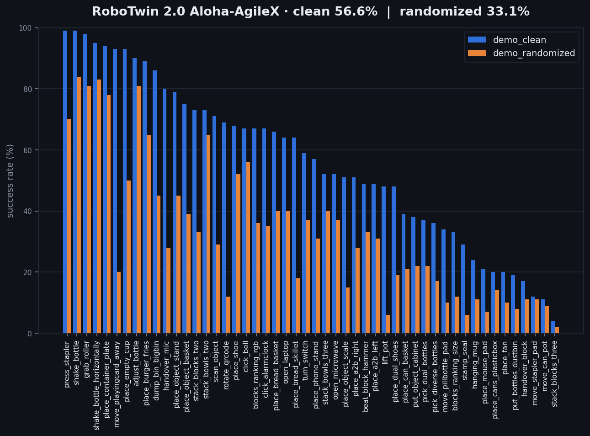

# RoboTwin 2.0 Aloha-AgileX 50 任务 — 提交代码材料

> **路径说明**：本目录是竞赛提交包快照，下文出现的 `src/`、`configs/`、`03_模型权重/`
> 是提交包内的布局。在 GitHub 仓库中，训练/推理实现在 `ours/`，复现脚本在根目录
> `scripts/`，最终权重放在 `assets/models/hf_ckpt_final_equiv10000`。
> 完整映射见 [../README.md](../README.md)。

本目录提供从官方预训练权重 `lingbot-vla-v2-6b` 出发,在 **RoboTwin 2.0 Aloha-AgileX 50 个任务 clean 数据(每任务 50 条)** 上完成训练与调优、并按官方协议评测的全部代码材料。

评测成绩:**demo_clean 56.6%(2829/5000)**、**demo_randomized 33.1%(1655/5000)**,两个 setting 均为 50 任务 × 每任务 100 次,0 跳过。



> 动图版:`../01_评测结果/eval_results_animation.gif`(逐任务成功率展开动画);
> 总览面板 `eval_results_dashboard.png`、热力图 `eval_results_heatmap.png`、回放视频 `videos/`;
> 生成脚本：提交包内 `scripts/make_results_gif.py`，GitHub 仓库中为根目录同名脚本
> (仅依赖 matplotlib,不需要 GPU)。

---

## 0. 第三方仓库与权重清单(复现所需)

### 0.1 官方第三方资源(全部为公开仓)

| 用途 | 来源 | 地址 | 说明 |
|---|---|---|---|
| **预训练基座** | ModelScope(官方) | `Robbyant/lingbot-vla-v2-6b` | 赛事指定基座,本次全部权重由它初始化 |
| 基座(镜像) | Hugging Face | `robbyant/lingbot-vla-v2-6b` | 官方同步版本 |
| **文本 tokenizer** | ModelScope | `Qwen/Qwen3-VL-4B-Instruct` | robot config 的 `tokenizer_path` 指向它 |
| **训练数据** | ModelScope 数据集 | `currytom/robotwin-lerobot-official-joint-v30` | 官方 RoboTwin 2.0 demo_clean 转 LeRobot v3.0;50 任务 × 每任务 50 条 |
| 训练数据(原始) | RoboTwin 2.0 | `robotwin2-demo-clean-official`(hdf5) | 上面的数据集由它转换而来 |
| **仿真框架** | GitHub | `robotwin-Platform/RoboTwin` @ `13c3c47` | 评测用仿真仓;官方 assets 约 16G,由 `script/_download_assets.sh` 下载 |
| 运动规划 | GitHub | `NVlabs/curobo` v0.7.8 | RoboTwin 硬依赖,官方 `_install.sh` 指定版本 |
| 仿真依赖 | pip | sapien 3.0.0b1 / mplib 0.2.1 / numpy 1.26.4 / gymnasium 0.29.1 / toppra 0.6.10 | 官方 `script/requirements.txt` |
| 训练依赖 | pip | torch 2.8.0+cu128 / flash_attn 2.8.3 / lerobot 0.4.2 | 训练仓 `requirements.txt` |
| 训练代码 | 本项目 | `klay-curry/Botgame`(本仓 `ours/`) | LingBot-VLA 2.0 训练/评测代码 |

### 0.2 团队产物

| 用途 | 来源 | 内容 |
|---|---|---|
| **提交权重** | 随包提供 `03_模型权重/checkpoint/` | `hf_ckpt_final_equiv10000`,等效 10000 步全量权重(12G,含 SHA-256) |
| 中间权重(复现训练用) | ModelScope `currytom/lingbotvla-robotwin-radeon-ckpt` | `hf_ckpt_step1000..6600` 等效 6600 步热启动点 |

### 0.3 一键拉取

```bash
bash ../03_模型权重/download_assets.sh all   # 官方基座 + tokenizer + 训练数据 + 团队中间权重
bash setup_sim_repo.sh                        # 克隆官方 RoboTwin@13c3c47 + 叠加本项目增量文件
```

---

## 0.4 我们的训练效果(单模型、单权重,无推理期增强)

从官方基座 `lingbot-vla-v2-6b` 出发,在官方 50 任务 clean 数据(每任务 50 条)上完成训练与调优,最终提交 **等效 10000 步**的全量权重。

| 阶段 | 设置 | 成绩 |
|---|---|---|
| 起点 | 官方 `lingbot-vla-v2-6b` | 闭环基本为 0%(数据语义不匹配:早期数据缺少零位形起步段) |
| 修复数据语义后 | 官方 joint_v30(14 维关节空间) | 闭环成功率恢复到 **50%+** 量级 |
| **最终提交(等效 10000 步)** | demo_clean,50 任务 × 100 局 | **56.6%**(2829/5000) |
| **最终提交(等效 10000 步)** | demo_randomized,50 任务 × 100 局 | **33.1%**(1655/5000) |
| 对照:等效 6600 步基线 | 20 任务同口径 | **19.2%** vs 本模型 52.5%(2.7 倍) |

**关键提升点**
1. **数据语义对齐(最大贡献)**:改用官方 14 维关节空间数据,并保证 episode 含"零位形起步段"(与评测环境初始状态一致),这一步把闭环成功率从 0 拉回 50%+;
2. **配方对齐官方基线**:AdamW / lr 5e-5 恒定 / warmup 3% / BF16 / global 96 / image_augment,步数从 6600 增到等效 10000;
3. **全量微调单权重**:未用 LoRA/DoRA,未外挂任何 vision/depth 模块,未做结构改动 → 提交的是一份可直接加载的全量权重。

**瓶颈定位(randomized 降幅分解)**:抓取/倾倒类任务降幅小(−8~−15pt),**依赖视觉定位/物体辨认的任务降幅大(−30~−57pt)** → 下一轮应优先攻视觉鲁棒性,而非继续堆动作侧步数。详见 `../reproduction_report.md` §7。

---

## 1. 目录结构

```text
02_代码材料/
├── README.md                      # 本文件
├── train.sh                       # 一键训练(两种模式:指定目录 / 自动拉取)
├── eval.sh                        # 一键评测(两种模式:指定目录 / 自动拉取)
├── setup_sim_repo.sh              # 克隆官方 RoboTwin@13c3c47 + 叠加本项目增量文件
├── configs/
│   ├── vla/robotwin/
│   │   ├── robotwin.yaml          # 训练基线配置(模型/数据/MoE/优化器等)
│   │   ├── robotwin_dist_muon.yaml# Muon 变体配置(历史基线,供对照)
│   │   └── robotwin_norm.yaml     # 仅含 norm 段的配置
│   ├── robot_configs/robotwin.yaml# robot config(14 维关节空间切片 + norm 类型)
│   ├── training_data/
│   │   └── robotwin_joint_v30.txt # 训练数据清单(50 行,每行 <任务名> <数据目录>)
│   └── robotwin_joint_v30.json    # 归一化统计(count=549787)
└── src/
    ├── gen_results_json.py        # 从原始日志生成官方模板 results.json(禁手填)
    ├── merge_randomized.sh        # 多分片评测结果合并
    ├── convert_dcp_to_hf.py       # DCP 断点 → HF 权重离线转换
    ├── deploy/
    │   └── lingbot_vla_v2_policy.py   # 推理服务(websocket 服务端)
    ├── script/
    │   ├── eval_policy_client_lingbotvla.py  # 评测客户端(RoboTwin 侧,test_num=100)
    │   ├── websocket_client_policy.py       # websocket 协议
    │   ├── msgpack_numpy.py
    │   └── __init__.py
    ├── RoboTwin_overlay/          # 叠加到官方 RoboTwin 仓的增量文件
    │   ├── script/eval_policy_client_lingbotvla.py
    │   ├── script/deploy/{__init__,websocket_client_policy,msgpack_numpy}.py
    │   └── script/update_embodiment_config_path.py
    ├── infer_repo/                # 推理侧代码仓(launcher + deploy)
    │   ├── experiment/robotwin/{start_robotwin_infer_and_eval.sh,eval_policy_client_lingbotvla.py}
    │   └── deploy/lingbot_vla_v2_policy.py
    └── experiment/robotwin/
        ├── start_robotwin_infer_and_eval.sh  # 评测主 launcher(推理服务 + 仿真队列调度)
        └── eval_policy_client_lingbotvla.py  # 客户端源文件(launcher 复制到 RoboTwin/script/)

03_模型权重/
├── checkpoint/                    # 本次提交权重 hf_ckpt_final_equiv10000(12G,含 SHA-256)
└── download_assets.sh             # 拉取官方基座 / tokenizer / 训练数据 / 团队中间权重
```

> 训练代码仓(LingBot-VLA 2.0 的 `train.sh` / `tasks/` / `assets/`)体积较大,未随包分发;
> `train.sh` 通过 `--repo <路径>` 指向它,详见 §4。

## 2. 依赖环境

| 组件 | 版本 | 说明 |
|---|---|---|
| 推理/训练环境 | conda `lingbotvla`, Python 3.12 | torch 2.8.0+cu128, flash_attn 2.8.3, lerobot 0.4.2 |
| 仿真环境 | conda `RoboTwin`, Python 3.10.21 | torch 2.4.1, sapien 3.0.0b1, mplib 0.2.1, numpy 1.26.4 |
| 运动规划 | curobo v0.7.8 | 以 editable 方式安装在 `RoboTwin/envs/curobo/src` |
| RoboTwin 源码 | `robotwin-Platform/RoboTwin` @ `13c3c47` | 官方仓库,仅按 §5 做了必要修复 |
| 硬件(本次评测) | 6 × NVIDIA RTX 4090 (48GB) | 驱动 595.71.05 / CUDA 13.2,单容器 1TB 内存 / 208 核 |

安装要点:
```bash
# 仿真环境(以 RoboTwin 官方 script/_install.sh 为准,需 curobo v0.7.8 源码)
# 训练环境: pip install -r requirements.txt(lingbotvla 仓)
# tokenizer: Qwen3-VL-4B-Instruct 放到 $QWEN3VL_PATH
```

## 3. 资源获取(权重 / tokenizer / 数据)

仓库根目录的 `scripts/download_assets.sh`（提交包内为 `03_模型权重/download_assets.sh`）
负责拉取全部外部资源：

```bash
bash scripts/download_assets.sh all              # 官方基座 + tokenizer + 训练数据 + 团队中间权重
bash scripts/download_assets.sh base             # 只拉官方基座 lingbot-vla-v2-6b
bash scripts/download_assets.sh tokenizer        # 只拉 Qwen3-VL-4B-Instruct
bash scripts/download_assets.sh data             # 只拉训练数据(官方 demo_clean → LeRobot v3.0)
bash scripts/download_assets.sh team             # 只拉团队中间权重(默认 step6600)
```
拉取源(全部为 ModelScope 官方/团队公开仓):
| 资源 | 仓库 | 用途 |
|---|---|---|
| 官方基座 | `Robbyant/lingbot-vla-v2-6b` | 模型主干初始化 / `model.config_path` |
| tokenizer | `Qwen/Qwen3-VL-4B-Instruct` | 文本编码器 tokenizer |
| 训练数据 | `currytom/robotwin-lerobot-official-joint-v30`(数据集) | 50 任务 × 50 条 clean 数据 |
| 团队中间权重 | `currytom/lingbotvla-robotwin-radeon-ckpt` | 等效 6600 步热启动点 |

默认落地目录(可用 `DEST_ROOT` 覆盖):`assets/models/lingbot-vla-v2-6b`、`assets/models/Qwen3-VL-4B-Instruct`、`assets/data/robotwin_official_joint_v30`、`assets/models/radeon_ckpt`。

> **最终权重(`hf_ckpt_final_equiv10000`)在提交包内为 `03_模型权重/checkpoint/`；
> GitHub 仓库中解压到 `assets/models/hf_ckpt_final_equiv10000`，不进入 git。**
> `team` 段仅在"想从头复现训练"时才需要(它提供等效 6600 步热启动点)。

RoboTwin 仿真仓不随包分发(官方 assets 约 16G),用 `scripts/setup_sim_repo.sh` 克隆官方仓:
```bash
bash scripts/setup_sim_repo.sh                 # 克隆官方 RoboTwin @13c3c47 → RoboTwin/
cd RoboTwin && bash script/_install.sh && bash script/_download_assets.sh && cd ..
```

## 4. 一键训练

```bash
# 模式 A:本地已有资源 → 显式指定目录
bash train.sh \
  --base-ckpt   <6600步权重目录> \
  --base-config <lingbot-vla-v2-6b 目录> \
  --tokenizer   <Qwen3-VL-4B-Instruct 目录> \
  --data        <robotwin_official_joint_v30 目录> \
  --repo        <LingBot-VLA 2.0 训练仓> \
  --out         <输出目录>

# 模式 B:本地缺资源 → 不传参数,脚本自动拉取缺失项
bash train.sh
```
`train.sh` 内部调用(关键参数):
```bash
bash train.sh tasks/vla/train_lingbotvla.py configs/vla/robotwin/robotwin.yaml \
  --train.micro_batch_size=24 --train.global_batch_size=96 \
  --train.gradient_accumulation_steps=1 --train.max_steps=3400 --train.save_steps=1000 \
  --train.enable_gradient_checkpointing=true --train.enable_fp32=false \
  --train.freeze_vision_encoder=false --train.optimizer=adamw \
  --train.lr=5e-5 --train.lr_min=5e-5 --train.lr_warmup_ratio=0.03 \
  --train.enable_resume=false --train.output_dir=<输出目录> \
  --model.model_path=<6600步权重> --model.config_path=<基座> --model.tokenizer_path=<tokenizer> \
  --data.train_path=assets/training_data/robotwin_joint_v30.txt \
  --data.image_augment=true --data.num_workers=8 --data.prefetch_factor=8
```
其他可调项:`--gpus / --micro-bs / --max-steps / --conda-sh / --train-env`。
路径默认值全部相对提交包根目录(`SUBMISSION_ROOT`),不依赖任何特定机器的目录结构。

## 5. 一键评测

```bash
# 模式 A:本地已有资源 → 显式指定目录
bash eval.sh --model <checkpoint 目录> --sim <RoboTwin 仿真仓> --infer <推理代码仓> --tokenizer <tokenizer 目录>

# 模式 B:本地缺资源 → 不传参数,自动拉取/克隆缺失项
bash eval.sh

# 两个 setting
bash eval.sh --setting demo_clean      --tasks 50
bash eval.sh --setting demo_randomized --tasks 50
```
可调项:`--gpus 6 --per-gpu 2 --precision bf16|fp32 --out <输出目录> --conda-sh <path>`。
- `eval.sh` 内部调用 `src/experiment/robotwin/start_robotwin_infer_and_eval.sh`,按 GPU 数启动常驻推理服务(websocket),仿真侧任务排队复用空闲槽位。
- 本次正式成绩使用 **6 卡 × 2 副本/卡 = 12 并发槽**,bf16 推理。
- 结果目录:`<output_base>/_<setting>_<时间戳>/`,内含 `stats.txt`(汇总)、`eval_logs/<task>.log`(逐 episode 原始日志)、`inference_logs/`。
- 由原始日志生成官方 `results.json`（GitHub 仓库中脚本在根目录 `scripts/`）：
  ```bash
  python3 scripts/gen_results_json.py   # 自动读取各 run 的 eval_logs,禁止手填
  ```

### 5.1 录制回放视频(实拍 rollout)

正式评测为提速默认关闭录像;需要素材时加 `--video`:

```bash
# 单任务录像(推荐:1 卡 1 槽,便于观察)
bash scripts/eval.sh --model <ckpt> --tasks 1 --gpus 1 --per-gpu 1 --video \
                     --setting demo_clean --out ./video_out
```
- 每个 episode 会存一个 mp4,位于 `<output_base>/_<setting>_<时间戳>/eval_results/<task>/`。
- 录像会明显拖慢仿真(额外渲染),建议只对少量任务开;全量评测保持默认关闭。
- 由结果数据制作的结果动图/静态图(不需要 GPU):
  ```bash
  python3 ../scripts/make_results_gif.py <results.json> <输出目录>
  # → eval_results_animation.gif, eval_results_summary.png
  ```

## 5. 对官方代码的修改说明(必读)

### 5.1 RoboTwin 官方评测代码的修改
| 文件 | 修改内容 | 原因 |
|---|---|---|
| `script/eval_policy_client_lingbotvla.py` | `test_num = 30` → **`test_num = 100`** | 官方 `script/eval_policy_client.py` 中该值为 100(每任务 100 次)。此前为筛选期临时改成 30,不符合提交协议,已还原为 100 |
| `script/eval_policy_client_lingbotvla.py` | 新增(本文件整体为官方 `eval_policy_client.py` 的适配版) | 官方客户端面向 HTTP 服务,本项目改为 websocket 通信,观测/动作序列化沿用官方 `script/deploy/websocket_client_policy.py` |
| `script/deploy/*` | 由训练仓 `deploy/` 复制 | 客户端 `from script.deploy.websocket_client_policy import WebsocketClientPolicy` 需要同级 msgpack_numpy |
| `script/update_embodiment_config_path.py` | 由官方仓保留并被 launcher 调用 | curobo 的 yml 里写死了 urdf 绝对路径,换机器需重生成 |

> 本次评测**未修改** RoboTwin 的任务定义、成功判定逻辑、场景/随机化逻辑与 seed 生成逻辑。

### 5.2 LingBot-VLA 2.0 官方代码的修改
- **模型结构、损失、优化器实现均未修改**。训练使用官方 `tasks/vla/train_lingbotvla.py` 与 `configs/vla/robotwin/robotwin.yaml`,仅通过命令行覆盖超参。
- `deploy/lingbot_vla_v2_policy.py` 为官方推理脚本,本次仅在调用时使用 bf16 精度参数(`--use_bf16 true --use_fp32 false`)。

### 5.3 评测 launcher 的并行增强
`start_robotwin_infer_and_eval.sh` 为**队列调度版** launcher(官方 `script/eval_policy.py` 是逐任务串行):
- N 个推理服务常驻(端口 9330+),仿真任务完成后立刻从队列取下一个任务复用该槽,任务不重叠、槽位不空转;
- 任务失败自动重试(最多 3 次),连续 3 次失败记为 skipped 并在 `stats.txt` 中显式标注;
- 队列尾部自适应关闭空闲推理服务;
- 本次全量评测曾把 50 任务拆成多组、用分片 launcher 并行跑（仅改 `task_list_all` 与 GPU 偏移/起始端口，
  评测逻辑完全相同）。分片副本属于一次性调度产物，**未保留在仓库当前树**（可在 git 历史中查到）；
  仓库只保留主 launcher，用 `--tasks / --gpus / --per-gpu` 即可覆盖同样的评测能力。

## 6. 合规性自查

| 赛事红线 | 本次提交 |
|---|---|
| 起点必须是 `lingbot-vla-v2-6b` | ✅ 全部权重由该底座初始化后训练 |
| 训练数据仅用 RoboTwin 2.0 Aloha-AgileX 50 任务 clean,每任务 50 条 | ✅ 50 任务 × 50 = 2500 eps / 549,787 frames,逐任务审计通过(见 `../reproduction_report.md`) |
| 禁止 randomized 数据参与训练 | ✅ 训练清单只有 clean;randomized 仅用于评测 |
| 禁止外部数据 | ✅ 仅用官方 RoboTwin 2.0 demo_clean 转 LeRobot v3.0 |
| 禁止 RL / 仿真 rollout / 重渲染观测 / reward 筛选等造数据手段 | ✅ 未使用,未生成任何新轨迹 |
| 最终只提交一份合并后的全量权重 | ✅ `03_模型权重/checkpoint/` 为全量微调权重(非 LoRA,无需 merge) |
| 禁止按 task ID / instruction 路由、ensemble、多 seed 投票、replanning | ✅ 单权重、单 seed、无投票、每步单次前向 |
| 允许:视觉/状态增强 | ✅ 训练开启 `image_augment=true` |

## 7. 结果

见 `../01_评测结果/results.json`(官方模板)与 `../reproduction_report.md`。
